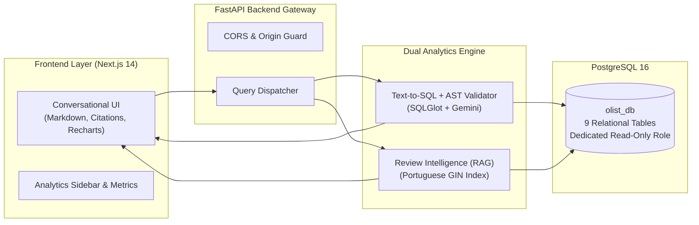

# Olist AI Assistant

> **Production-grade AI Analytics Platform for the Brazilian Olist E-Commerce Ecosystem.**  
> Powered by Next.js 14, TypeScript, Tailwind CSS, FastAPI, PostgreSQL, and Google Gemini.

[](https://fastapi.tiangolo.com)
[](https://nextjs.org)
[](https://www.postgresql.org)
[](https://ai.google.dev)
[](https://www.typescriptlang.org)
[](https://tailwindcss.com)

---

## 1. Project Overview

The **Olist AI Assistant** empowers business leaders, data analysts, and store operations managers to query over **98,000 orders**, **112,000 order items**, and **99,000 customer reviews** using natural language in English or French. 

Unlike simple conversational bots or static dashboards, this system features a **Dual-Engine Architecture**:
1. **Dynamic Text-to-SQL Engine**: Translates natural language questions into safe, executable PostgreSQL queries with AST-level security validation, self-healing query correction, and business intelligence synthesis.
2. **Review Intelligence & Semantic Search (RAG)**: Classifies customer complaints across 8 operational categories using Portuguese linguistic stemming, calculates non-overlapping statistical distributions, and retrieves cited review evidence.

---

## 2. Key Audited Platform Baselines (PostgreSQL Ground Truth)

All metrics are validated against the real Olist database (`olist_db`):

| Key Metric | Validated Value | Business Context |
| :--- | :--- | :--- |
| **Total Merchandise Revenue** | **R$ 13,591,643.70** | `SUM(price)` across 112,650 order items |
| **Total Registered Orders** | **99,441 orders** | Registered records in `orders` (96,478 delivered, 97.02% delivery rate) |
| **Purchased Orders (with items)** | **98,666 orders** | Orders with line items (775 unfulfilled/canceled prior to line items; 97.78% fulfillment) |
| **Total Customer Base** | **96,096 unique buyers** | Repeat purchase rate is 3.12% (2,997 repeat buyers with $\ge 2$ orders) |
| **Customer Order Records** | **99,441 checkout tokens** | One `customer_id` per registered order |
| **Merchant Ecosystem** | **3,095 active sellers** | Distributed across Brazilian states (SP leads with >65%) |
| **Catalog Depth** | **32,951 products** | Categorized into 73 distinct retail categories (avg weight 2,276.47g) |
| **Average Rating** | **4.09 / 5.00 stars** | Platform average across all 99,224 customer reviews |
| **Customer Feedback** | **42,687 written reviews** | Average written rating is 3.70★; 10,861 negative reviews |

---

## 3. System Architecture



---

## 4. Security & Robustness Highlights

- **SQLGlot AST Parsing**: Queries are parsed into an Abstract Syntax Tree before execution. Rejects any mutation (`INSERT`, `UPDATE`, `DELETE`, `DROP`, `ALTER`, `TRUNCATE`), administrative commands, or data exfiltration (`SELECT ... INTO`).
- **Table Whitelist**: Only 9 sanctioned public schema tables can be queried. All PostgreSQL catalog tables (`pg_shadow`, `information_schema`) are strictly rejected.
- **Dedicated Read-Only User**: Dynamic SQL executes under `olist_readonly` with zero write or DDL permissions.
- **Statement Timeout**: Enforces `SET statement_timeout = 5000;` (5 seconds) on every connection to prevent denial-of-service from unindexed Cartesian joins.
- **Automatic Limit Injection**: Queries without a limit are automatically capped at `LIMIT 50`.
- **Offline Fallback Engine**: If Gemini APIs encounter 429 quota exhaustion or 503 latency spikes, the system automatically falls back to an offline deterministic synthesis engine.

---

## 5. Example Questions Across 11 Business Domains

The assistant handles complex natural language inquiries:

1. **Simple Metrics**: *"What is the total revenue of Olist?"* / *"What is the average freight value per item?"*
2. **Aggregations**: *"Which payment method is used most frequently?"*
3. **Time-Series & Growth**: *"How many orders were placed each month in 2017?"* / *"Show me monthly revenue for 2018."*
4. **Multi-Table Joins**: *"What are the top 5 product categories by revenue?"*
5. **Geographic Distribution**: *"Which states have the highest sales volume?"* / *"Compare São Paulo and Rio de Janeiro order volumes."*
6. **Customer Retention**: *"What is the repeat customer rate and how many customers bought more than once?"*
7. **Seller Performance**: *"Who are the top 10 sellers by revenue?"* / *"Do sellers with faster shipping get better review ratings?"*
8. **Delivery & Logistics**: *"What is the average delivery time in days by customer state?"* / *"Which states have the worst late delivery rate?"*
9. **Customer Reviews & Complaints**: *"Why are customers giving 1-star reviews?"* / *"What percentage of complaints are about delivery delays?"*
10. **Complex Business Scenarios**: *"Show me high-revenue categories that suffer from below-average customer satisfaction."*
11. **Bilingual Queries (French & English)**: *"Quel est le revenu total d'Olist?"* / *"Quelles sont les principales plaintes des clients?"*

---

## 6. Project Structure

```
├── Dockerfile.backend          # Production FastAPI container definition
├── Dockerfile.frontend         # Production Next.js multi-stage container
├── docker-compose.yml          # Container orchestration (DB, API, Web)
├── .env.example                # Unified environment template
├── .gitignore                  # Git exclusions for secrets and builds
├── docs/                       # Technical documentation
│   ├── ARCHITECTURE.md         # Full system architecture & dataflow
│   ├── DATA_DICTIONARY.md      # Schema specifications & audited reference metrics
│   ├── SECURITY.md             # Threat model, AST validation & read-only hardening
│   ├── API.md                  # Complete REST API specifications
│   └── DEPLOYMENT.md           # Local, Docker, and cloud deployment guides
├── backend/                    # FastAPI application
│   ├── app/
│   │   ├── main.py             # ASGI entry point & lifecycle management
│   │   ├── config.py           # Pydantic Settings & environment validation
│   │   ├── database.py         # SQLAlchemy engine with readonly session pool
│   │   ├── routers/            # Chat & review endpoints
│   │   ├── schemas/            # Pydantic request & response models
│   │   └── services/           # Text-to-SQL, LLM cascade, Review Intelligence
│   ├── tests/                  # 83+ unit tests & 27 E2E comprehensive tests
│   └── requirements.txt        # Python dependencies
└── src/                        # Next.js 14 frontend application
    ├── app/                    # App Router pages and layout
    ├── components/             # ChatMessage, ChatInput, MetricCard, Sidebar, Charts
    ├── hooks/                  # Conversational state hooks
    └── types/                  # TypeScript interface definitions
```

---

## 7. Quickstart Guide

### Option A: Local Development

```bash
# 1. Start Backend
cd backend
python -m venv .venv
.\.venv\Scripts\Activate.ps1    # On Windows
pip install -r requirements.txt
cp .env.example .env            # Add your GEMINI_API_KEY
uvicorn app.main:app --reload --port 8000

# 2. Start Frontend (in new terminal)
npm install
npm run dev
```

Visit `http://localhost:3000` to interact with the assistant.

### Option B: Docker Compose

```bash
cp .env.example .env            # Configure GEMINI_API_KEY
docker-compose up --build -d
```

---

## 8. Automated Testing & Verification

Run the comprehensive test suites:

```bash
# Run backend test suite (83 unit + security tests)
set PYTHONPATH=backend
backend\.venv\Scripts\python.exe -m unittest discover -s backend/tests

# Run frontend production build & TypeScript validation
npx tsc --noEmit
npm run build
```

---

## 9. License

This project is licensed under the MIT License. Built using public data from the Brazilian E-Commerce Public Dataset by Olist on Kaggle.
