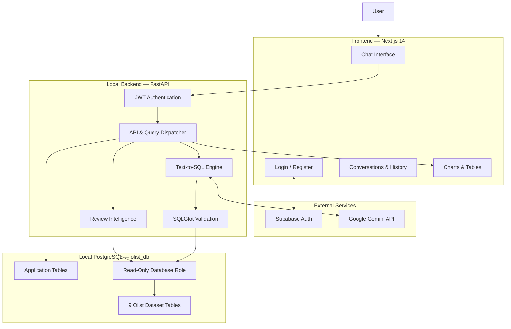

# Olist AI Assistant

> **An AI-powered analytics assistant for exploring the Brazilian Olist E-Commerce dataset using natural language.**

Olist AI Assistant is a local analytics platform that allows users to explore more than 98,000 e-commerce orders through conversational questions in English or French. It combines natural-language-to-SQL generation, PostgreSQL analytics, customer review intelligence, and interactive data visualizations.

**Built with:** Next.js 14 · TypeScript · Tailwind CSS · FastAPI · PostgreSQL · Google Gemini

---

## 1. Project Overview

The platform transforms business questions into actionable insights without requiring users to write SQL manually.

Its main capabilities include:

- **Natural Language Analytics:** Ask questions about revenue, orders, customers, products, sellers, payments, and logistics.
- **Text-to-SQL:** Convert natural-language questions into PostgreSQL queries using Gemini.
- **SQL Security:** Validate generated queries before execution using SQLGlot AST parsing and read-only database permissions.
- **Review Intelligence:** Analyze Portuguese customer reviews and identify recurring complaint themes using keyword-based classification.
- **Interactive Visualizations:** Display analytical results through charts, tables, and KPI summaries.
- **Conversational History:** Maintain separate conversations and continue previous analytical discussions.
- **Bilingual Experience:** Interact with the assistant in English or French.

---

## 2. Technology Stack

| Layer | Technologies |
|---|---|
| Frontend | Next.js 14, React, TypeScript |
| Styling | Tailwind CSS |
| Visualizations | Recharts |
| Icons | Lucide React |
| Backend | Python, FastAPI |
| Database | Local PostgreSQL |
| ORM / Database Access | SQLAlchemy |
| AI Engine | Google Gemini API |
| SQL Validation | SQLGlot |
| Authentication | Supabase Auth |
| Version Control | Git, GitHub |

---

## 3. System Architecture

The application uses a local-first architecture.

- The Next.js frontend handles the user interface and authentication state.
- Supabase Cloud provides email/password authentication only.
- FastAPI handles requests, validates authentication tokens, and coordinates analytics.
- Local PostgreSQL stores the Olist dataset and application data.
- Gemini provides natural-language understanding, SQL generation, and analytical explanations.



### Local and Cloud Responsibilities

| Component | Responsibility | Location |
|---|---|---|
| Next.js | User interface | Local |
| FastAPI | Backend API | Local |
| PostgreSQL | Analytics and application storage | Local |
| Supabase | User authentication | Cloud |
| Gemini | AI-powered analysis | Cloud |
| GitHub | Private source-code repository | Cloud |

**Important:** Supabase is not used as the application's analytics database. Olist data and application conversations are stored in the local PostgreSQL database.

---

## 4. Database & Dataset

The project uses the Brazilian E-Commerce Public Dataset by Olist.

The local PostgreSQL database is named `olist_db` and contains nine relational dataset tables alongside application tables.

### Dataset Baselines

| Metric | Value |
|---|---:|
| Total registered orders | 99,441 |
| Orders with purchased items | 98,666 |
| Order items | 112,650 |
| Unique customers | 96,096 |
| Active sellers | 3,095 |
| Products | 32,951 |
| Product categories | 73 |
| Customer reviews | 99,224 |
| Written customer reviews | 42,687 |
| Merchandise revenue | R$ 13,591,643.70 |

*These figures describe the imported historical dataset and its current analytical definitions.*

### Database Architecture

**Olist dataset tables**

- Customers
- Orders
- Order Items
- Products
- Sellers
- Payments
- Reviews
- Geolocation
- Product Category Translation

**Application tables**

The local database also stores application-related information, including user profiles, conversations, messages, and usage records.

---

## 5. Core Features

### 5.1 Natural Language to SQL

Users can ask questions such as:

- What is the total revenue generated by Olist?
- Which product categories generate the most revenue?
- What are the top 10 sellers by sales?
- How many orders were placed each month in 2017?
- Which Brazilian states have the highest sales volume?
- What is the average delivery time?

The backend uses Gemini to generate SQL, validates the query, executes it against PostgreSQL, and returns structured results.

### 5.2 SQL Security

Generated SQL queries pass through multiple security layers:

- SQLGlot AST parsing and validation.
- Read-only `SELECT` query enforcement.
- Approved table allowlist.
- Rejection of data modification and administrative operations.
- Automatic query result limits.
- Database statement timeout.
- Dedicated `olist_readonly` database permissions.

These safeguards help prevent unsafe SQL execution and restrict access to the approved analytical dataset.

### 5.3 Review Intelligence

The platform analyzes customer feedback written in Portuguese.

It identifies recurring complaint themes across eight operational categories using a keyword-based classification approach with Portuguese linguistic processing.

Capabilities include:

- Negative review analysis.
- Complaint category distribution.
- Identification of recurring customer problems.
- Review evidence retrieval.
- Analytical summaries of customer dissatisfaction.

**Note:** Complaint categories are based on keyword classification, not a trained semantic machine-learning classifier. Statistical definitions and possible overlap between complaint mentions should be considered when interpreting results.

### 5.4 Interactive Analytics

Analytical responses can be presented using:

- KPI summaries.
- Data tables.
- Bar charts.
- Line charts.
- Pie and donut charts.
- Time-series analysis.

### 5.5 Conversational Experience

The application supports:

- Multiple independent conversations.
- Conversation history.
- Contextual follow-up questions.
- Separate processing states for different conversations.
- Markdown-formatted analytical responses.

---

## 6. Authentication & Security

Authentication is handled by Supabase Auth, while application analytics remain local.

Current authentication features:

- Email and password registration.
- Email confirmation.
- Email and password login.
- Password recovery.
- Password reset.
- Session management.
- Protected application routes.
- Logout and session cleanup.
- Backend JWT verification.
- User-specific conversation isolation.

Google OAuth has been removed from the current interface. Authentication uses email and password.

The frontend communicates with Supabase for authentication, while the backend validates authentication tokens before accessing protected application functionality.

**Security practices:**

- Environment variables for sensitive credentials.
- `.env` and `.env.local` excluded from Git.
- No API secrets committed to the repository.
- Read-only database access for analytical queries.
- SQL validation before execution.

---

## 7. Example Business Questions

The assistant supports questions across multiple business domains.

| Domain | Example Question |
|---|---|
| Revenue | What is the total merchandise revenue? |
| Sales | Which categories generate the highest revenue? |
| Customers | What is the repeat purchase rate? |
| Sellers | Who are the top 10 sellers? |
| Products | Which products have the highest sales? |
| Payments | What is the most frequently used payment method? |
| Logistics | Which states have the highest late-delivery rate? |
| Geography | Compare sales between São Paulo and Rio de Janeiro. |
| Reviews | Why are customers giving one-star reviews? |
| Time Series | Show monthly revenue throughout 2018. |
| Advanced Analytics | Find high-revenue categories with below-average customer satisfaction. |

The assistant supports both English and French questions.

---

## 8. Project Structure

```text
AI_ASSISTANT/
│
├── backend/
│   ├── app/
│   │   ├── core/
│   │   │   └── auth.py
│   │   ├── routers/
│   │   ├── services/
│   │   ├── schemas/
│   │   ├── config.py
│   │   ├── database.py
│   │   └── main.py
│   │
│   ├── migrations/
│   ├── tests/
│   ├── requirements.txt
│   └── .env
│
├── src/
│   ├── app/
│   │   ├── auth/
│   │   ├── login/
│   │   ├── register/
│   │   ├── forgot-password/
│   │   └── ...
│   │
│   ├── components/
│   ├── context/
│   ├── hooks/
│   ├── lib/
│   └── types/
│
├── docs/
│   ├── ARCHITECTURE.md
│   ├── DATA_DICTIONARY.md
│   ├── SECURITY.md
│   └── SUPABASE_SETUP.md
│
├── .env.example
├── .gitignore
├── .env.local
├── package.json
└── README.md
```

*The structure above highlights the main application areas; individual files may evolve as development continues.*

---

## 9. Local Installation & Setup

### Prerequisites

- Windows 10/11.
- Python 3.10 or later.
- Node.js and npm.
- PostgreSQL.
- A Supabase project for authentication.
- A Google Gemini API key.

### Step 1 — Clone the Repository

```bash
git clone https://github.com/Abderrahmane-Shadow/olist-ai-assistant.git
cd olist-ai-assistant
```

### Step 2 — Configure Environment Variables

Configure the backend environment in:

```text
backend/.env
```

Configure the frontend environment in:

```text
.env.local
```

The frontend requires:

```env
NEXT_PUBLIC_API_URL=http://localhost:8000
NEXT_PUBLIC_SUPABASE_URL=YOUR_SUPABASE_URL
NEXT_PUBLIC_SUPABASE_PUBLISHABLE_KEY=YOUR_SUPABASE_PUBLISHABLE_KEY
```

The backend requires the appropriate configuration for:

- Local PostgreSQL connections.
- Gemini API access.
- Supabase JWT verification.
- Authentication settings.
- CORS configuration.

Refer to `.env.example` and `docs/SUPABASE_SETUP.md` for configuration details.

**Never commit real API keys, database passwords, or secret credentials.**

### Step 3 — Start the Backend

Open a terminal at the project root:

```powershell
.\backend\.venv\Scripts\python.exe -m uvicorn app.main:app --host 127.0.0.1 --port 8000 --reload --app-dir backend
```

Backend API:

```text
http://localhost:8000
```

API documentation:

```text
http://localhost:8000/docs
```

### Step 4 — Start the Frontend

Open a second terminal:

```powershell
npm install
npm.cmd run dev
```

Frontend:

```text
http://localhost:3000
```

### Step 5 — Access the Application

Open the frontend in your browser, register using your email address, confirm your email, and sign in.

The PostgreSQL service must be running, and the local database and required tables must already be configured.

---

## 10. Testing & Validation

### Backend Tests

```powershell
.\backend\.venv\Scripts\python.exe -m unittest discover -s backend/tests
```

### Frontend TypeScript Validation

```bash
npx tsc --noEmit
```

### Frontend Production Build

```bash
npm run build
```

### API Documentation

FastAPI automatically provides interactive API documentation:

```text
http://localhost:8000/docs
```

---

## 11. Current Deployment Model

Olist AI Assistant is currently designed as a **personal local application**.

- Frontend runs locally.
- Backend runs locally.
- PostgreSQL runs locally.
- Supabase provides cloud authentication.
- Gemini provides cloud AI capabilities.
- GitHub stores the private source-code repository.

There is no public application deployment in the current setup.

---

## 12. Future Improvements

Potential future enhancements include:

- More advanced semantic analysis of customer reviews.
- Additional analytical and predictive models.
- Improved query optimization and caching.
- More advanced business intelligence visualizations.
- Expanded analytical capabilities and reporting.

---

## 13. Dataset & License

The project uses the **Brazilian E-Commerce Public Dataset by Olist**, available on Kaggle.

The application source code is licensed under the MIT License.

---

**Developed as a Data Science and Business Intelligence project, combining conversational AI, database analytics, and interactive data exploration.**
