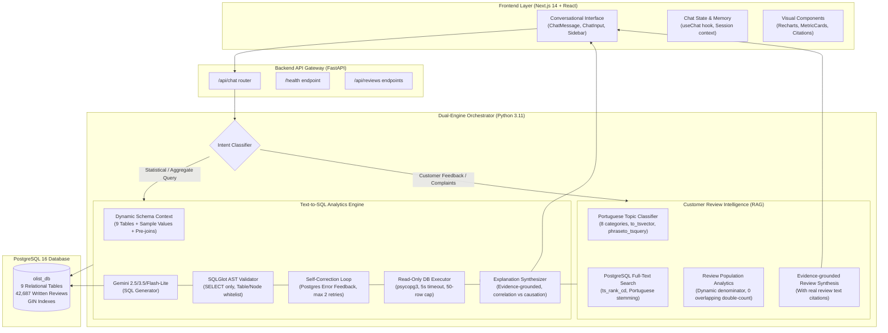

# Olist AI Assistant - Architecture & Technical Specification

## 1. System Overview

The **Olist AI Assistant** is a production-grade, conversational intelligence system built over the Brazilian Olist E-Commerce dataset (98k+ orders, 99k+ customer reviews, R$13.59M revenue, 2016–2018). It combines:
1. **Dynamic Text-to-SQL Analytics**: Open-ended SQL code generation, AST-level validation, multi-layer query correction, and natural-language synthesis.
2. **Review Intelligence & Semantic Search (RAG)**: Full-text indexing in Portuguese, complaint topic classification across 8 taxonomies, rating distribution analysis, and cited review retrieval.
3. **Responsive Conversational Web Interface**: Next.js 14, Tailwind CSS, Lucide icons, responsive sidebar, Markdown renderer with math & tables, and interactive Recharts visualizations.

---

## 2. End-to-End System Architecture

---

## 3. Dual-Engine Query Lifecycle

### Path A: Quantitative Analytics (Text-to-SQL)
1. **User Query**: e.g., *"What were our top 5 revenue categories in Q3 2017 and their average freight?"*
2. **Context Injection**: Pre-engineered schema context (`OLIST_SCHEMA_CONTEXT`) with foreign keys, data grain warnings (e.g., `SUM(oi.price)` vs `COUNT(DISTINCT o.order_id)`), and date filters (`order_status = 'delivered'`).
3. **SQL Generation**: Google Gemini transforms natural language into standard PostgreSQL dialect.
4. **AST Validation**: SQLGlot parses query into an Abstract Syntax Tree. Rejects any non-SELECT statements, mutations, DDL, table modifications, or access to sensitive tables (`pg_catalog`, `information_schema`).
5. **Execution**: Query runs against a dedicated read-only role (`olist_readonly`) with a hard `5000ms` statement timeout and automatic `LIMIT 50` enforcement.
6. **Error Correction**: If Postgres throws a syntax or column error, the error is fed back to Gemini to self-heal in up to 2 retry attempts.
7. **Business Synthesis**: Results are passed back to Gemini with strict guidelines to distinguish correlation from causation, cite exact values, and report known data boundaries.

### Path B: Qualitative Feedback & Complaints (Review RAG)
1. **User Query**: e.g., *"Why are customers giving 1-star reviews for bed bath & table?"*
2. **Dynamic Classification**: Text is classified against Portuguese linguistic patterns into 8 operational buckets:
   - Delivery delays (`atraso`, `demora`, `prazo`)
   - Damaged/defective goods (`defeito`, `quebrado`, `estragado`)
   - Wrong or missing items (`veio faltando`, `produto errado`)
   - Packaging issues (`embalagem rasgada`, `amassada`)
   - Refund & billing issues (`estorno`, `cancelamento`, `cobrança`)
   - Seller communication (`não respondem`, `sem contato`)
   - Product quality (`material ruim`, `baixa qualidade`)
   - Other complaints (strictly mutually exclusive remainder)
3. **Evidence Retrieval**: GIN index queries retrieve top cited reviews sorted by `ts_rank_cd`.
4. **Grounding**: Denominators are calculated dynamically over the relevant written review population.

---

## 4. Resilience & Fallback Hierarchy

- **Model Cascades**: Primary: `gemini-3.8-flash` $\rightarrow$ Secondary: `gemini-2.5-flash` $\rightarrow$ Tertiary: `gemini-3.5-flash-lite`.
- **429 Quota & 503 Outage Fallback**: If Gemini APIs encounter high demand or quota limits, the system automatically falls back to an offline deterministic synthesis engine that analyzes query tabular results and produces markdown summaries, metrics, and chart recommendations without interrupting the user.
